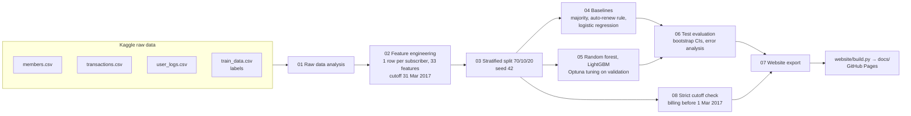

# Early Prediction of Subscription Churn Using Listening Patterns and Temporal Engagement Features

Can you tell, from a music subscriber's billing record and listening habits, whether they will leave once their plan runs out? We built a model that predicts churn for 946,686 KKBOX subscribers using only what was known on 31 March 2017, and tested it once on a held-out 20% split. The tuned LightGBM model reaches **PR-AUC 0.9644** (95% CI 0.9624 to 0.9664), against 0.3164 for a simple "auto-renew is off" rule. Almost all of that comes from billing records. Listening behaviour adds only +0.0083 PR-AUC on top of billing, but when billing is cut off earlier, at 1 March, listening adds **+0.1474**. The 0.9644 is an upper bound, because March billing often already records the renewal; with billing cut at 1 March (before any labelled plan expires; listening still covers March) the model reaches **PR-AUC 0.5682** (0.5610 to 0.5757), 6.3 times the no-skill level. That is closer to an early warning, but not a pure 1 March prediction.

ES 335 Machine Learning course project.

- **Website (full report, data studio and live predictor):** https://destopianpirate.github.io/es335_final2/
- **Dataset (Kaggle):** https://www.kaggle.com/competitions/customer-retention-datathon-riyadh-edition/data
- **Repository:** https://github.com/destopianpirate/es335_final2

**Team**

| Name | Roll number |
|---|---|
| Ayush Singh | 25110068 |
| Avnish Yadav | 25110067 |

## Why

A music subscription earns money only while people keep renewing. If a service can tell *before* a plan runs out who is likely to leave, it can spend its retention budget (reminders, discounts, offers) on those subscribers instead of on everyone. Billing records are what a business already watches. Listening shows engagement, so we ask whether it gives a signal that billing does not. The task is hard because only 9% of subscribers churn, many profiles are incomplete, and the billing window overlaps the label window.

## Research question

Using only what is known on 31 March 2017, can we predict whether a KKBOX subscriber whose plan expires in March 2017 will churn (no new valid subscription within 30 days after that plan expires), and does listening behaviour add value beyond billing records?

One row is one subscriber, and the target is `is_churn`. 8.99% of the 946,686 labelled subscribers churn (85,147), so the classes are imbalanced. That is why we use PR-AUC as the main score instead of accuracy: a model that says "nobody churns" is already 91% accurate.

**What the model may use at prediction time**

| Setting | Allowed inputs | How to read the score |
|---|---|---|
| Main, cutoff 31 March 2017 | member profile, billing up to 31 March, March listening | upper bound: most labelled plans have already expired, so billing often already shows the renewal |
| Strict, billing cut at 1 March 2017 | member profile, billing before 1 March (before any labelled plan expires), March listening | closer to early warning, but listening still runs to 31 March |
| Never | anything dated after 31 March 2017, the label | every choice is made on validation; the test split is scored once |

**Scope of the claim.** One cohort of one service (KKBOX plans expiring in March 2017), a random split within that month, and association, not cause: the scores say who is likely to leave, not why, and not how a later month would look.

## Our approach

- **Data.** Five Kaggle tables: labels, member profiles (6.8M rows), transactions (1.4M rows) and daily listening logs (18.4M rows). Notebook 01 checks each one. For example, 67.2% of member ages are invalid and 65.4% of genders are blank, and 4,200 log rows have impossible listening times.
- **Features.** Notebook 02 builds 33 features per subscriber in three groups:
  - Demographic (6): city, registration channel, gender, age, tenure.
  - Billing (15): transaction count, amount paid, plan length, auto-renew and cancel history, payment method, days since the last transaction and days until the plan expires.
  - Listening (12): active days, total hours, seconds and songs per day, unique-song ratio, skip and completion ratios, last-7-day share, days since the last activity, and how variable daily listening is.
- **Split.** Notebook 03 makes a stratified 70/10/20 train/validation/test split (seed 42). All feature analysis is done on the training split only.
- **Models.** We go from simple to complex: majority class, then a one-line rule (auto-renew off means churn), logistic regression, random forest, LightGBM with default settings, and LightGBM tuned with Optuna. Each step shows how much it gains over the previous one, and a model that loses to the rule would point to a bug. The three learned models cover the three main families for tabular data, one idea each: linear (is a straight-line boundary enough?), bagged trees (do thresholds and interactions matter?) and boosted trees (do trees that correct each other do better?).
- **Tuning.** All tuning happens on the validation split. Logistic regression uses a C grid, the random forest uses a 4-setting grid, and LightGBM gets 30 Optuna (TPE) trials over learning rate 0.05–0.2, 15–63 leaves, min. leaf size 20–400, row and column sampling and L2, with early stopping. Models are selected by validation log loss, a proper scoring rule that rewards honest probabilities; the selected model is also best on validation PR-AUC. The decision threshold (0.45) is chosen on validation by F1. The test split is scored once at the end.
- **Evaluation.** We report PR-AUC, ROC-AUC, log loss, Brier score and F1, with 95% bootstrap intervals (1,000 resamples). Differences between models use a paired bootstrap: the tuned LightGBM beats default LightGBM by +0.0025 [0.0016, 0.0038], the random forest by +0.0049 [0.0041, 0.0056] and logistic regression by +0.0698 [0.0666, 0.0732] test PR-AUC (`results/model_comparison.csv`); the ablation and strict check use 500 resamples. The validation split is reused for early stopping, Optuna, model choice and the threshold, so validation scores are slightly optimistic; the test split is scored once. Intervals cover test sampling, not training variance (one seed per model). On top of that come a feature-group ablation with a paired bootstrap, calibration, a gains curve, recall per segment and error analysis. Notebook 08 then runs a strict-cutoff sensitivity check.

**Pipeline**



## Results (test split, 189,338 subscribers)

| Model | PR-AUC | ROC-AUC | Log loss | Brier | F1 at threshold 0.45 |
|---|---|---|---|---|---|
| Majority (prior) | 0.0899 | 0.5000 | 0.3024 | 0.0819 | 0.0000 |
| Rule: auto-renew off | 0.3164 | 0.7748 | 0.2286 | 0.0632 | 0.5248 |
| Logistic regression (tuned) | 0.8946 | 0.9767 | 0.0873 | 0.0217 | 0.8468 |
| Random forest (tuned) | 0.9596 | 0.9946 | 0.0489 | 0.0138 | 0.8942 |
| LightGBM (default) | 0.9619 | 0.9953 | 0.0467 | 0.0134 | 0.8950 |
| **LightGBM (tuned, final model)** | **0.9644** (0.9624 to 0.9664) | **0.9958** | **0.0452** | **0.0131** | **0.8976** |

The final model has 861 trees, 50 leaves and a learning rate of 0.067. At threshold 0.45 it catches 15,545 of the 17,029 churners in the test split (recall 0.913) with 2,063 false alarms (precision 0.883). Its probabilities are well calibrated where it makes predictions: across 10 equal-size bins of test subscribers, predicted and observed churn differ by at most 0.007 (top decile: 85.4% predicted, 85.1% observed), and the Brier score is 0.0131 against 0.0819 for the majority baseline. Almost all predictions are near 0 or near 0.85, so the middle range is rarely tested. If you contact the 10% of subscribers it rates riskiest, you reach 94.6% of all churners.

### Where the signal comes from

We retrained the same tuned LightGBM on each feature group:

| Feature set | Features | PR-AUC (95% CI) | ROC-AUC |
|---|---|---|---|
| Listening + demographics | 18 | 0.3967 (0.3880 to 0.4042) | 0.8017 |
| Billing + demographics | 21 | 0.9562 (0.9540 to 0.9583) | 0.9952 |
| All features | 33 | 0.9644 (0.9624 to 0.9662) | 0.9958 |

Billing alone gets close to the full model. Adding listening on top raises PR-AUC by **+0.0083** (paired bootstrap 95% CI 0.0073 to 0.0093), which is small but clearly above zero. By split gain, billing features account for 93.4% of the model, listening for 4.8% and demographics for 1.8%. The top features are `days_until_expiration` (51.4%), `last_is_cancel` (16.2%) and `days_since_last_tx` (9.5%). The most useful listening feature is `days_since_last_active`.

### Strict cutoff check (notebook 08)

The labelled plans expire during March 2017, and 95.4% of subscribers have a transaction dated in March. Those subscribers churn at 5.5%, while the rest churn at 80.9%. So by 31 March the billing record often already shows the renewal decision, and the scores above are optimistic for early warning. Notebook 08 rebuilds every billing feature from transactions before **1 March 2017** (before any labelled expiry) and retrains the same tuned LightGBM on the same split:

| Model (same test split) | PR-AUC (95% CI) | ROC-AUC | F1 at validation threshold |
|---|---|---|---|
| Majority (prior) | 0.0899 | 0.5000 | 0.0000 |
| Rule: auto-renew off (strict) | 0.1418 | 0.5553 | 0.0984 |
| Strict billing + demographics | 0.4208 (0.4134 to 0.4276) | 0.8023 | 0.3818 |
| **Strict billing + demographics + listening** | **0.5682** (0.5610 to 0.5757) | **0.8614** | **0.5269** |
| Original final model (31 March billing) | 0.9644 | 0.9958 | 0.8976 |

Under the strict cutoff, listening adds +0.1474 PR-AUC (paired bootstrap 95% CI +0.1426 to +0.1524), far more than at 31 March. Listening looks most useful when billing does not already reveal the outcome. One caveat: March listening can fall after a subscriber's expiry date, so part of this gain may still reflect the outcome. Table: `results/strict_cutoff_metrics.csv`.

## Leakage checks

| Possible leak | What we did | Status |
|---|---|---|
| Data from after the cutoff | Nothing dated after 31 March 2017 is in the inputs: transactions end on 31 Mar 2017 and the logs cover March 2017 only, so no date filter is needed. | Handled |
| Billing already shows the renewal | 95.4% of subscribers have a March transaction (churn 5.5% vs 80.9% for the rest). Notebook 08 rebuilds billing from before 1 March: PR-AUC falls from 0.9644 to 0.5682. | Measured |
| Listening after a subscriber's expiry | March listening can fall after an individual plan's expiry, so part of listening's +0.1474 at 1 March may still reflect the outcome. | Open |
| Preprocessing fitted on held-out data | Medians, scalers and one-hot codes are fitted inside each pipeline on the training split only. No feature selection. | Handled |
| Tuning on the test split | Hyperparameters, threshold and feature sets were chosen on validation; test was scored once (notebook 06). | Handled |
| Same subscriber in two splits | One row per subscriber (`msno`), split by row. | Handled |

## Highlights

**Key decisions**

- **PR-AUC as the main score**, not accuracy. Only 9% of subscribers churn, so accuracy hides a useless model (Saito and Rehmsmeier, 2015).
- **A ladder of models from a one-line rule to tuned LightGBM.** Each step has to beat the one below it, so every gain can be explained.
- **Test split scored once.** Every choice (hyperparameters, threshold, feature sets) was made on validation first.
- **Paired bootstrap for comparisons.** Both models are scored on the same resampled subscribers, so the interval is for the difference itself.
- **We checked our own leakage.** When we found that March billing already shows most renewals, we added the 1 March strict-cutoff check to measure how much of the score it explains.

**Failure modes** (test split, threshold 0.45: 1,484 of 17,029 churners missed, 2,063 false alarms)

- **Plans expiring within 30 days of the cutoff.** This is the largest group (158,450 subscribers, 1.85% churn), and recall drops to 0.595. Most missed churners (1,187 of 1,484) are here.
- **Auto-renew on.** 36.6% of missed churners still had auto-renew switched on, so their billing looks like a loyal subscriber's.
- **Subscribers with no transactions.** Most of the false alarms (1,233 of 2,063) come from this small group of 7,248 subscribers, who churn at 78%.
- **Active listeners.** Recall is 0.892 for subscribers with March logs, against 0.985 for those without: people who keep listening but still leave are hard to spot.

## The website

https://destopianpirate.github.io/es335_final2/ presents the project interactively:

- **Home:** the question, the headline numbers, the answer at a glance, who did what, and how to reproduce it.
- **Report:** the full write-up in 16 numbered sections: Why, Data, Preprocessing, Evaluation, Baseline and methods, Leakage, Results, Errors, Failure modes, Runtime model, Limitations, Conclusion, What next, Reproduction steps, AI assistance, and Libraries and data. It opens with "The answer in short" and an "On this page" list. Collapsible "How it works" boxes explain each method and why we chose it, and a table gives a verdict for each question we set out to answer.
- **Data Studio:** explore the raw tables and features, including churn rates by group and how the files overlap.
- **Model Predictor:** score a subscriber yourself with the real model (see below).

### Runtime model

The predictor runs the exact tuned LightGBM (`models/lgbm_champion.txt`, 861 trees) in JavaScript, with no server. Notebook 07 exports every tree to `website/js/generated/model_lgbm.js` (2.9 MB), and `website/js/sandbox_engine.js` walks the trees the same way LightGBM does, including missing values and categorical splits. `node website/tests/check_model_parity.mjs` compares the browser with Python: on 300 test rows the largest difference in churn probability is 1.1e-16, and on 100 form inputs it is 3.5e-18 (PASS). The form asks for the 16 features a person can know about a subscriber. Of the other 17, 3 presence flags are set to 1, 6 are worked out from the inputs, and about 8 payment-history features are filled with the training median for subscribers with the same auto-renew and cancel status (about 5% of the model's split gain). So it illustrates the model; it does not score real subscribers. City, registration channel and payment method are shown as their numeric codes, because the dataset does not give their names.

## Repository

```
data/raw/          the 5 Kaggle CSVs (not committed, see Data access)
data/processed/    feature tables, split_assignments.csv, X and y files per split
notebooks/         01 to 08 (run 08 before 07)
models/            fitted models and model_config.json
results/           metric tables, figures, submission.csv
scripts/           export_ds_extra.py: extra Data Studio tables (churn by group, file overlap); export_val_test_metrics.py: every model on validation and test, paired model comparisons
website/           website source and build script
docs/              built website (GitHub Pages)
```

| Notebook | Content | Main outputs |
|---|---|---|
| 01_raw_data_analysis | the 5 raw tables: sizes, types, missing values, quality checks, distributions | `results/raw_summary.json`, `raw_*.png` |
| 02_feature_engineering | one row per subscriber, 33 features from profile, transactions and March listening | `data/processed/` feature table, `data_summary.json` |
| 03_feature_analysis_and_split | stratified 70/10/20 split (seed 42), then feature analysis on the training split | `split_assignments.csv`, `feature_*.png`, `eda_summary.json` |
| 04_baselines | majority and rule baselines, logistic regression tuned on validation | `models/baselines.joblib`, `tuning_logreg.json`, `validation_baselines.csv` |
| 05_tree_models_and_tuning | random forest grid, LightGBM with Optuna, decision threshold, feature set ablation | `models/lgbm_*.txt`, `random_forest.joblib`, `model_config.json`, `validation_metrics.csv` |
| 06_test_evaluation | test metrics and curves, bootstrap intervals, error analysis | `test_metrics.csv`, `evaluation.json`, `test_*.png` |
| 07_website_export | data for the website, the final model as JavaScript, predictions for the Kaggle test subscribers | `website/js/generated/`, `submission.csv` |
| 08_strict_cutoff | sensitivity check: billing features from before 1 March 2017, same split and hyperparameters | `strict_cutoff.json`, `strict_cutoff_metrics.csv` |

## Setup and run

```bash
git clone https://github.com/destopianpirate/es335_final2.git
cd es335_final2
pip install -r requirements.txt
# put the five CSVs in data/raw/ (see Data access)
cd notebooks
for nb in 01 02 03 04 05 06 08 07; do   # 08 before 07, which exports its results to the site
  jupyter nbconvert --to notebook --execute --inplace ${nb}_*.ipynb
done
cd ..
python scripts/export_ds_extra.py   # extra Data Studio tables, needs data/raw (a few minutes)
python scripts/export_val_test_metrics.py   # every model on validation and test + paired comparisons (val_test_metrics.csv, model_comparison.csv)
python website/build.py   # writes the site to docs/, repo link defaults to this repository
node website/tests/check_model_parity.mjs   # optional: browser model matches Python
python -m http.server 8000 -d docs   # view the site at http://localhost:8000
```

Python 3.11+ (tested on 3.14), about 8 GB RAM, about 30 minutes for all notebooks. Exact package versions are in `requirements.txt` (pandas 2.3.3, scikit-learn 1.8.0, LightGBM 4.7.0, Optuna 4.8.0). All seeds are fixed (split 42, models 42, Optuna 42, bootstrap 0). LightGBM and the random forest train on all CPU threads, so results can differ in the last decimal places on a different machine or thread count; the conclusions do not change.

### Check the numbers

After notebook 06, `results/test_metrics.csv` should show the tuned LightGBM at PR-AUC 0.9644, ROC-AUC 0.9958 and log loss 0.0452 on 189,338 test subscribers. On validation, `results/validation_metrics.csv` should show PR-AUC 0.9686. `results/val_test_metrics.csv` repeats the test numbers exactly and adds validation precision 0.8942, recall 0.9224, F1 0.9081 and accuracy 0.9832 for the tuned LightGBM at τ = 0.45. After notebook 08, `results/strict_cutoff_metrics.csv` should show 0.4208 (billing + demographics) and 0.5682 (with listening).

## Data access

Kaggle, Customer Retention Datathon (Riyadh Edition): https://www.kaggle.com/competitions/customer-retention-datathon-riyadh-edition/data (you need to accept the competition rules). The data comes from KKBOX's 2017 WSDM churn challenge. The raw files are not committed because they are larger than GitHub's file size limit and are distributed by Kaggle.

| file in `data/raw/` | Kaggle file | rows | covers labelled subscribers |
|---|---|---|---|
| `train_data.csv` + `kaggle_test_data.csv` | `train_v2.csv` (946,686 labelled + 24,274 unlabelled) | 970,960 | all |
| `members.csv` | `members_v3.csv` | 6,769,473 | 88.7% |
| `transactions.csv` | `transactions_v2.csv` (Jan 2015 to Mar 2017) | 1,431,009 | 96.1% |
| `user_logs.csv` | `user_logs_v2.csv` (March 2017) | 18,396,362 | 77.7% |

One row is a labelled subscriber (`train_data`), an unlabelled subscriber (`kaggle_test_data`), a member profile (`members`), a payment or plan change (`transactions`), or one subscriber-day of listening (`user_logs`).

Integrity checks on the raw files: no duplicate IDs in `train_data`, `kaggle_test_data` or `members`; no exact duplicate rows in `transactions`; no duplicate subscriber-day in `user_logs`; labels are only 0 and 1; no subscriber is in both the labelled and the Kaggle test list; transactions run 1 Jan 2015 to 31 Mar 2017 and logs 1 to 31 Mar 2017.

## Limitations

- The 31 March results are optimistic for early warning, because March billing often already contains the renewal (see the strict cutoff check).
- Even under the strict cutoff, some March listening falls after a subscriber's expiry date.
- The split is random, not by time, so it doesn't test how the model holds up in a later month. A time split was not possible: the data labels only one cohort (plans expiring in March 2017) and the logs cover that month only, so we used a stratified random split by subscriber.
- Many member profiles are incomplete (60% of ages missing after cleaning), so demographics add little.

## What next

- **Split by time, not at random:** train on earlier months and test on a later one.
- **Cut listening at each subscriber's own expiry date**, so the strict check has no post-expiry signal.
- **Choose the threshold by cost**, from the real cost of a lost subscriber versus a wasted offer, instead of F1.
- **A model for plans expiring soon after the cutoff**, where recall drops to 0.595.

## Conclusion

Churn is very predictable on 31 March (PR-AUC 0.9644, an upper bound), but mostly because March billing already shows many renewal decisions. Billing carries almost all of the signal, and listening adds only +0.0083. With billing cut at 1 March the task is much harder (PR-AUC 0.5682), and listening becomes worth +0.1474, though part of that gain may come from listening after a plan has lapsed, since the strict model still sees listening through 31 March. Engagement data looks most useful when billing has not yet revealed the outcome; a clean test would cut listening at each subscriber's expiry.

## Individual contributions

### Avnish Yadav (25110067): data quality, billing, baselines, ablation, errors, Data Studio

- **Contribution.** Profiled the five tables and their quality issues; built the 15 billing features, including the latest-transaction fields; set up the baselines and tuned logistic regression and the random forest on validation; ran the feature-group ablation, the error analysis and the failure modes; designed the Data Studio.
- **Key choices.** Left joins with presence flags instead of dropping subscribers, because those with no transactions churn at 78.8%. `log1p` and scaling for logistic regression only, because of heavy skew (`tx_count` skew 22.8). Settings picked by validation log loss, never by test.
- **Evaluation.** Every learned model beats the auto-renew rule (0.3164): logistic regression 0.8946, random forest 0.9596 test PR-AUC. Billing + demographics alone reach 0.9562, and listening adds only +0.0083 [0.0073, 0.0093] at 31 March.
- **Limitation.** The errors concentrate where the data has no warning sign: plans expiring within 30 days, where recall is 0.595. Their billing looks loyal and their listening looks active.
- **A small change.** Dropping subscribers missing from any table, instead of left-joining, would remove about 25% of them, including the no-transaction group that churns at 78.8%. The scores would look better on an easier test set, but the model would never learn to flag that group.

### Ayush Singh (25110068): listening and profile features, split, LightGBM, evaluation, leakage, Report

- **Contribution.** Built the 12 listening and 6 profile features and the joins with presence flags; made the stratified 70/10/20 split with all learned preprocessing on the training split; tuned LightGBM with Optuna, set the threshold, ran the test evaluation and the strict 1 March check; wrote the Report and built the Live Predictor.
- **Key choices.** PR-AUC as the main metric, because always saying "renews" is already 91% accurate. Model chosen by validation log loss; threshold 0.45 chosen by F1 on validation; test scored once. No class reweighting, so probabilities stay calibrated.
- **Evaluation.** The tuned LightGBM reaches 0.9644 [0.9624, 0.9664] test PR-AUC and beats default LightGBM by +0.0025 [0.0016, 0.0038] in a paired bootstrap. Validation and test differ by at most about 0.01.
- **Limitation.** 0.9644 is an upper bound, because March billing often already records the renewal. With billing cut at 1 March the score is 0.5682, and that model still sees listening through March.
- **A small change.** Lowering the threshold from 0.45 to 0.20 would catch 16,453 instead of 15,545 test churners (recall 0.913 to 0.966), but false alarms would rise from 2,063 to 3,382 (precision 0.883 to 0.829). It is worth it only if a lost subscriber costs much more than a wasted offer.

## AI-use disclosure

We took help of Antigravity and Claude Code for getting the codes for the data processing, model building, understanding the concepts, restructurizing the repo and codes for better deployment. We also took help for building the website. But the ideas, final insights and decisions are our own.

## Libraries and references

- **LightGBM** (Ke et al., 2017): the gradient-boosted tree models and the browser model export.
- **Optuna** (Akiba et al., 2019): hyperparameter search for LightGBM.
- **scikit-learn** (Pedregosa et al., 2011): logistic regression, random forest, the split and the metrics.
- **pandas** and **NumPy**: data tables, feature building and bootstrap resampling.
- **PyArrow**: reading and writing processed tables.
- **Matplotlib**: every figure in `results/figures/`.
- **joblib**: saving the fitted models.
- **Jupyter / nbconvert**: running the notebooks.

References

- KKBOX. WSDM KKBox's Churn Prediction Challenge, Kaggle, 2017.
- Ke, G. et al. LightGBM: A Highly Efficient Gradient Boosting Decision Tree. NeurIPS 2017.
- Akiba, T. et al. Optuna: A Next-generation Hyperparameter Optimization Framework. KDD 2019.
- Pedregosa, F. et al. Scikit-learn: Machine Learning in Python. JMLR 12, 2011.
- Saito, T. and Rehmsmeier, M. The Precision-Recall Plot Is More Informative than the ROC Plot When Evaluating Binary Classifiers on Imbalanced Datasets. PLoS ONE 10(3), 2015.
