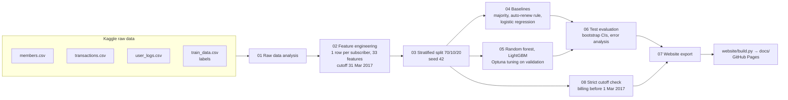

# Early Prediction of Subscription Churn Using Listening Patterns and Temporal Engagement Features

ES 335 Machine Learning course project.

- **Website:** https://destopianpirate.github.io/es335_final/
- **Dataset (Kaggle):** https://www.kaggle.com/competitions/customer-retention-datathon-riyadh-edition/data
- **Repository:** https://github.com/destopianpirate/es335_final

**Team**

| Name | Roll number |
|---|---|
| Ayush Singh | 25110068 |
| Avnish Yadav | 25110067 |

**Pipeline**



**Question.** Using only what is known on 31 March 2017, can we predict whether a KKBOX subscriber will churn (no new subscription within 30 days after their plan expires), and does listening behaviour add value beyond billing records? One row is one subscriber; the target is `is_churn`.

## Results (test split, 189,338 subscribers)

| Model | PR-AUC | ROC-AUC | Log loss | F1 at threshold 0.45 |
|---|---|---|---|---|
| Majority (prior) | 0.0899 | 0.5000 | 0.3024 | 0.0000 |
| Rule: auto-renew off | 0.3164 | 0.7748 | 0.2286 | 0.5248 |
| Logistic regression (tuned) | 0.8946 | 0.9767 | 0.0873 | 0.8468 |
| Random forest (tuned) | 0.9596 | 0.9946 | 0.0489 | 0.8942 |
| LightGBM (default) | 0.9619 | 0.9953 | 0.0467 | 0.8950 |
| **LightGBM (tuned)** | **0.9644** (95% CI 0.9624 to 0.9664) | **0.9958** | **0.0452** | **0.8976** |

Billing features carry most of the signal; adding listening features raises PR-AUC by 0.0083 (paired bootstrap 95% CI 0.0073 to 0.0093). Full tables: `results/test_metrics.csv`, `results/validation_metrics.csv`.

### Strict cutoff check (notebook 08)

The labelled plans expire during March 2017, and 95.4% of subscribers have a transaction dated in March (they churn at 5.5%, the rest at 80.9%). So by 31 March the billing record often already shows the renewal decision. The scores above are therefore optimistic for early warning. Notebook 08 rebuilds every billing feature from transactions before **1 March 2017** (before any labelled expiry) and retrains the same tuned LightGBM on the same split:

| Model (same test split) | PR-AUC (95% CI) | ROC-AUC | F1 at validation threshold |
|---|---|---|---|
| Majority (prior) | 0.0899 | 0.5000 | 0.0000 |
| Rule: auto-renew off (strict) | 0.1418 | 0.5553 | 0.0984 |
| Strict billing + demographics | 0.4208 (0.4134 to 0.4276) | 0.8023 | 0.3818 |
| **Strict billing + demographics + listening** | **0.5682** (0.5610 to 0.5757) | **0.8614** | **0.5269** |
| Original champion (31 March billing) | 0.9644 | 0.9958 | 0.8976 |

Under the strict cutoff listening adds +0.1474 PR-AUC (paired bootstrap 95% CI +0.1426 to +0.1524), far more than at 31 March: listening matters most when billing does not already reveal the outcome. Caveat: March listening can fall after a subscriber's expiry, so part of this gain may still reflect the outcome. Table: `results/strict_cutoff_metrics.csv`.

## Repository

```
data/raw/          the 5 Kaggle CSVs (not committed, see Data access)
data/processed/    feature tables, split_assignments.csv, X and y files per split
notebooks/         01 to 08 (run 08 before 07)
models/            fitted models and model_config.json
results/           metric tables, figures, submission.csv
scripts/           export_ds_extra.py: extra Data Studio tables (churn by group, file overlap)
website/           website source and build script
docs/              built website (GitHub Pages)
```

| Notebook | Content |
|---|---|
| 01_raw_data_analysis | the 5 raw tables: sizes, types, missing values, quality checks, distributions |
| 02_feature_engineering | one row per subscriber, 33 features from profile, transactions and March listening |
| 03_feature_analysis_and_split | stratified 70/10/20 split (seed 42), then feature analysis on the training split |
| 04_baselines | majority and rule baselines, logistic regression tuned on validation |
| 05_tree_models_and_tuning | random forest grid, LightGBM with Optuna, decision threshold, feature set ablation |
| 06_test_evaluation | test metrics and curves, bootstrap intervals, error analysis |
| 07_website_export | data for the website and the champion model as JavaScript |
| 08_strict_cutoff | sensitivity check: billing features from before 1 March 2017, same split and hyperparameters |

## Setup and run

```bash
pip install -r requirements.txt
# put the five CSVs in data/raw/ (see Data access)
cd notebooks
for nb in 01 02 03 04 05 06 08 07; do   # 08 before 07, which exports its results to the site
  jupyter nbconvert --to notebook --execute --inplace ${nb}_*.ipynb
done
cd ..
python scripts/export_ds_extra.py   # extra Data Studio tables, needs data/raw (a few minutes)
python website/build.py   # writes the site to docs/, repo link defaults to this repository
node website/tests/check_model_parity.mjs   # optional: browser model matches Python
```

Python 3.11+, about 8 GB RAM, about 30 minutes for all notebooks.

## Data access

Kaggle, Customer Retention Datathon (Riyadh Edition): https://www.kaggle.com/competitions/customer-retention-datathon-riyadh-edition/data (requires accepting the competition rules). The raw files are not committed because they exceed GitHub's file size limit and are distributed by Kaggle.

| file in `data/raw/` | Kaggle file | rows |
|---|---|---|
| `train_data.csv` + `kaggle_test_data.csv` | `train_v2.csv` (946,686 labelled + 24,274 unlabelled) | 970,960 |
| `members.csv` | `members_v3.csv` | 6,769,473 |
| `transactions.csv` | `transactions_v2.csv` | 1,431,009 |
| `user_logs.csv` | `user_logs_v2.csv` | 18,396,362 |

## AI-use disclosure

We took help of AI Tools in building the website.

## Citations

- KKBOX. WSDM KKBox's Churn Prediction Challenge, Kaggle, 2017.
- Ke, G. et al. LightGBM: A Highly Efficient Gradient Boosting Decision Tree. NeurIPS 2017.
- Akiba, T. et al. Optuna: A Next-generation Hyperparameter Optimization Framework. KDD 2019.
- Pedregosa, F. et al. Scikit-learn: Machine Learning in Python. JMLR 12, 2011.
- Saito, T. and Rehmsmeier, M. The Precision-Recall Plot Is More Informative than the ROC Plot When Evaluating Binary Classifiers on Imbalanced Datasets. PLoS ONE 10(3), 2015.
